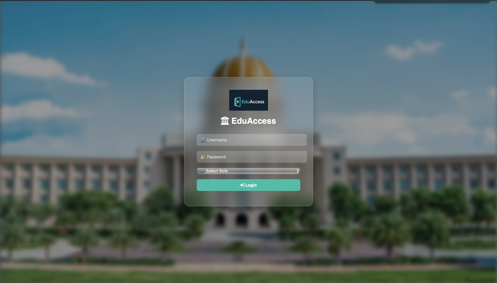
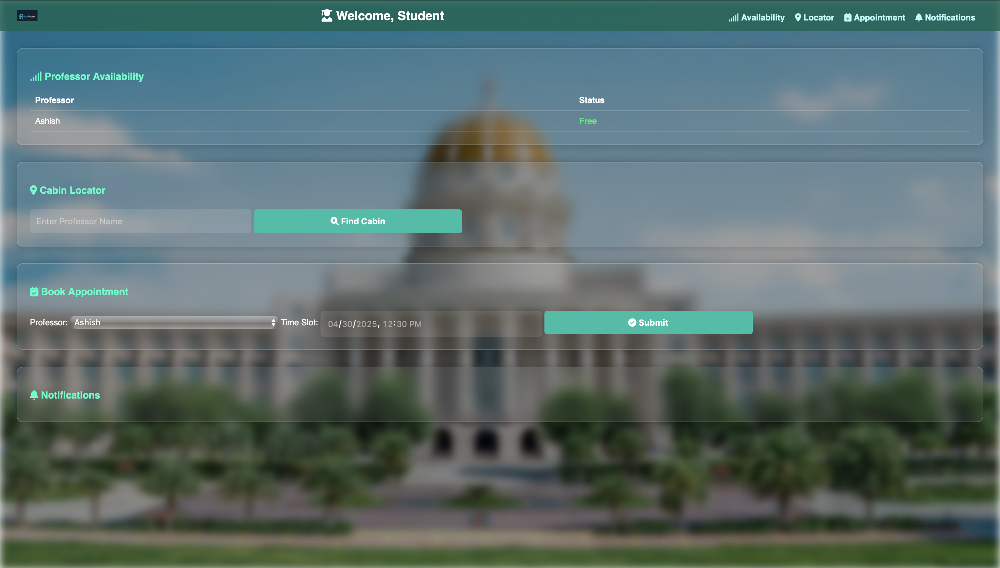
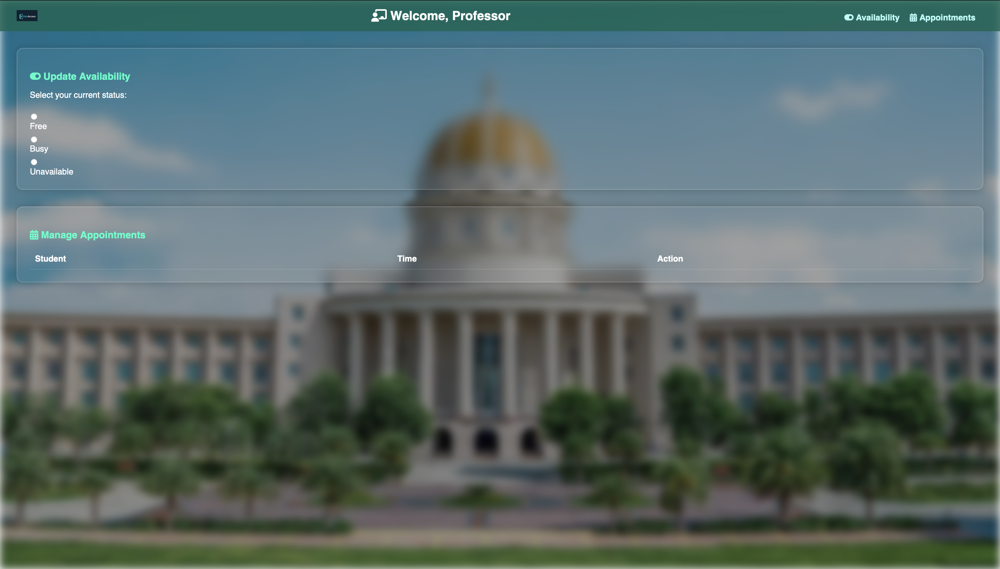

# 📘 EduAccess: Faculty Availability & Cabin Locator System

EduAccess is a full-stack web platform designed to streamline faculty-student interactions in university campuses. It enables real-time professor availability updates, cabin location lookup, and appointment booking based on roles (Student/Professor).

---

## 🚀 Features

- 🔐 **Role-Based Login**: Users land on the dashboard for their account role; dashboards and API are permission-checked server-side.
- 👨‍🏫 **Professor Dashboard**:  
  - Update availability status (Free, Busy, Unavailable)  
  - View and manage appointment requests
- 🎓 **Student Dashboard**:  
  - Check real-time professor availability  
  - Book appointments by selecting date & time  
  - Search professor cabin locations
- 🔔 **Notifications**: Professors are notified of new requests; students are notified when a request is confirmed or cancelled.
- ♻️ **Auto Refresh**: Dashboards auto-update availability every 10 seconds.
- 🎨 **Responsive UI**: Clean, modern interface with background blur, animations, and dropdown interactions.

---

## 🛠️ Tech Stack

| Layer        | Technology                     |
|--------------|--------------------------------|
| Frontend     | HTML, CSS, JavaScript (Vanilla) |
| Backend      | Django 6.1, Django REST Framework |
| Database     | PostgreSQL                     |
| Real-time    | JavaScript polling (setInterval) |
| Deployment   | (Planned) Docker + Heroku/Render |

---

## 📁 Project Structure

```bash
EduAccess/
├── api/                     # Django App
│   ├── models.py            # User, Appointment, Notification
│   ├── views.py             # REST APIs
│   ├── serializers.py
│   ├── urls.py
├── eduaccess_backend/      # Django Project settings
├── frontend/
│   ├── templates/           # HTML Files (index, student-dashboard, professor-dashboard)
│   ├── static/
│   │   ├── js/script.js     # Frontend logic & AJAX
│   │   ├── css/styles.css   # Custom styling
│   │   └── assets/          # Logo and background images
├── manage.py
├── README.md                # This file
```

---

## 🧪 Local Setup

Requires Python 3.12+ and PostgreSQL (or SQLite for a quick local run).

```bash
git clone https://github.com/lakshya110704/EduAccess.git
cd EduAccess
python3 -m venv .venv && source .venv/bin/activate
pip install -r requirements.txt
cp .env.example .env          # fill in values; DJANGO_DEBUG=True + DB_ENGINE=sqlite for local dev
python manage.py migrate
python manage.py seed_demo    # optional demo users (DEBUG only)
python manage.py runserver
```

Open `http://127.0.0.1:8000/` and log in; you are sent to the dashboard for your role.
Admin panel: `http://127.0.0.1:8000/admin/` (create a user with `python manage.py createsuperuser`).

Run the tests:

```bash
DB_ENGINE=sqlite DJANGO_DEBUG=True python manage.py test api
```

Every push also runs the suite on GitHub Actions against PostgreSQL 16 (`.github/workflows/ci.yml`).

### Dependencies

`requirements.in` lists direct dependencies; `requirements.txt` is the generated lock file (every package pinned, with hashes). To change a dependency, edit `requirements.in` and regenerate:

```bash
uv pip compile requirements.in -o requirements.txt --generate-hashes --python-version 3.12 --python-platform linux
```

Dependabot opens weekly pull requests for available updates; CI tests each before it is merged.

## 🚀 Production notes

- Set `DJANGO_SECRET_KEY`, `DJANGO_ALLOWED_HOSTS`, `DJANGO_CSRF_TRUSTED_ORIGINS` and the `DB_*` variables; leave `DJANGO_DEBUG` unset.
- `python manage.py collectstatic --noinput`, then run `gunicorn eduaccess_backend.wsgi` behind an HTTPS proxy that sets `X-Forwarded-Proto`.
- `/healthz/` returns `{"status": "ok"}` for load-balancer checks.

---

## 📷 Screenshots

| Login | Student Dashboard | Professor Dashboard |
|-------|-------------------|---------------------|
|  |  |  |

---

## 🙌 Contributors

- Lakshya Mehta
- Mohini

---

