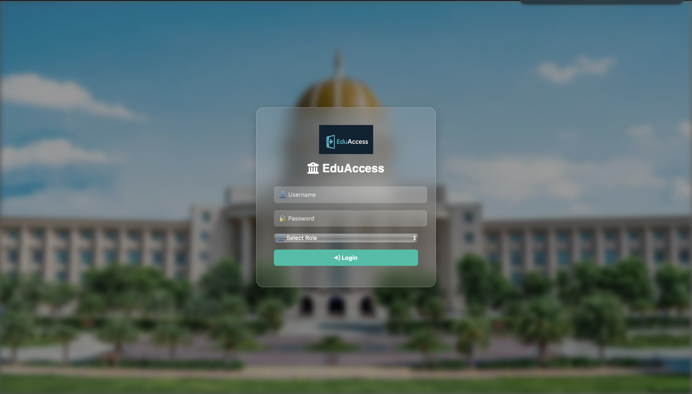
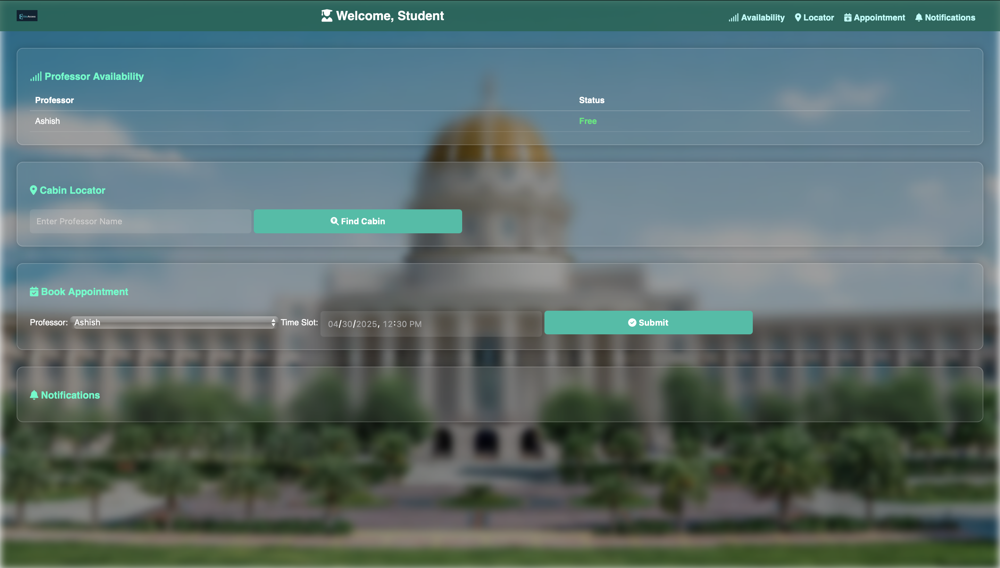
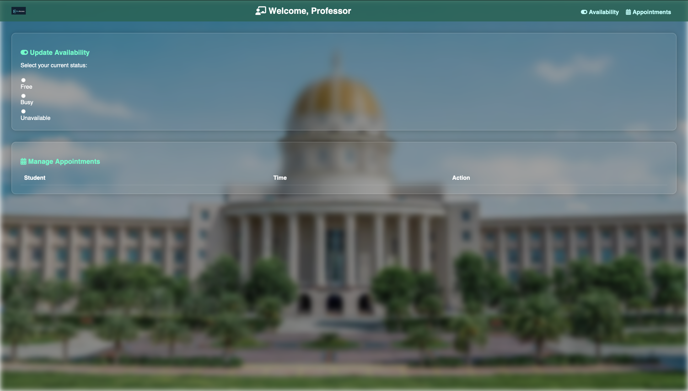

# 📘 EduAccess: Faculty Availability & Cabin Locator System

EduAccess is a full-stack web platform designed to streamline faculty-student interactions in university campuses. It enables real-time professor availability updates, cabin location lookup, and appointment booking based on roles (Student/Professor).

---

## 🚀 Features

- 📝 **Self sign-up**: Students (`@muj.manipal.edu`) and professors (`@jaipur.manipal.edu`) request an account with their college email and roll number / employee ID; an admin activates it.
- 🔐 **Role-Based Login**: Pick Student or Professor and log in; it only succeeds if the account has that role. Dashboards and API are permission-checked server-side.
- 👨‍🏫 **Professor Dashboard**:  
  - Update availability status (Free, Busy, Unavailable)  
  - View and manage appointment requests
  - Set walk-in **open time** for today; students see it immediately and can't book inside it
  - Set the cabin on first login (required before anything else), change it later from the Cabin pop-up
- 🎓 **Student Dashboard**:  
  - Keep a "My professors" list (search everyone, ☆ add) with live availability  
  - Book 15-minute slots (or two for 30 minutes); a slot is booked once the professor accepts, and overlapping requests are declined automatically
  - Search professors by name or cabin
- 📍 **Cabin directions**: Cabins are written `AB2 FB3 : 106` (Academic Block 2, Faculty Block 3, cabin 106). Each one links to a shareable directions page: Google Maps walking directions to the block, then written steps inside (floor and directions are optional per faculty block), with a WhatsApp share and a Back button.
- 🧹 **Clutter-free dashboards**: only My Professors, My Appointments and Notifications on the page; find and book open as pop-ups.
- 🔔 **Notifications**: Professors are notified of new requests; students are notified when a request is confirmed or cancelled.
- ♻️ **Auto Refresh**: Dashboards auto-update availability every 10 seconds.
- 🎨 **Responsive UI**: Clean, modern interface with background blur, animations, and dropdown interactions.

---

## 🛠️ Tech Stack

| Layer        | Technology                     |
|--------------|--------------------------------|
| Frontend     | HTML, CSS, JavaScript (Vanilla) |
| Backend      | Django 6.1, Django REST Framework |
| Database     | PostgreSQL                     |
| Real-time    | JavaScript polling (setInterval) |
| Deployment   | Docker Compose, auto-deployed from CI on every push to `main` |

---

## 📁 Project Structure

```bash
EduAccess/
├── api/                     # Django App
│   ├── models.py            # User, Appointment, OpenTime, MyProfessor, campus blocks, Notification
│   ├── views.py             # REST APIs
│   ├── serializers.py
│   ├── urls.py
├── eduaccess_backend/      # Django Project settings
├── frontend/
│   ├── templates/           # HTML pages (login, sign-up, dashboards, cabin, directions)
│   ├── static/
│   │   ├── script.js        # Dashboard logic & API calls
│   │   ├── styles.css       # Custom styling
│   │   └── assets/          # Logo and background images
├── manage.py
├── README.md                # This file
```

---

## 🧪 Local Setup

Requires Python 3.12+ and PostgreSQL (or SQLite for a quick local run).

```bash
git clone https://github.com/lakshya110704/EduAccess.git
cd EduAccess
python3 -m venv .venv && source .venv/bin/activate
pip install -r requirements.txt
cp .env.example .env          # fill in values; DJANGO_DEBUG=True + DB_ENGINE=sqlite for local dev
python manage.py migrate
python manage.py seed_demo    # optional demo users (DEBUG only)
python manage.py runserver
```

Open `http://127.0.0.1:8000/` and log in; you are sent to the dashboard for your role.
Admin panel: `http://127.0.0.1:8000/admin/` (create a user with `python manage.py createsuperuser`).

Run the tests:

```bash
DB_ENGINE=sqlite DJANGO_DEBUG=True python manage.py test api
```

Every push also runs the suite on GitHub Actions against PostgreSQL 16 (`.github/workflows/ci.yml`).

### Dependencies

`requirements.in` lists direct dependencies; `requirements.txt` is the generated lock file (every package pinned, with hashes). To change a dependency, edit `requirements.in` and regenerate:

```bash
uvx --python 3.12 --from pip-tools pip-compile --generate-hashes --strip-extras requirements.in
```

Dependabot opens weekly pull requests for available updates; CI tests each before it is merged.

### Linting and formatting

Python is checked with Ruff and the frontend JavaScript with Biome; CI fails on any finding. To check locally:

```bash
pip install -r requirements-dev.txt && npm ci
ruff check . && ruff format --check . && npx biome ci frontend/static
```

## 🚀 Production notes

- Set `DJANGO_SECRET_KEY`, `DJANGO_ALLOWED_HOSTS`, `DJANGO_CSRF_TRUSTED_ORIGINS` and the `DB_*` variables; leave `DJANGO_DEBUG` unset.
- Docker: `cp .env.production.example .env`, fill it in, then `docker compose up -d --build`. This starts PostgreSQL and the app (gunicorn) on `127.0.0.1:8000`; migrations run on every start. Put an HTTPS proxy that sets `X-Forwarded-Proto` in front of it.
- `/healthz/` returns `{"status": "ok"}` for load-balancer checks.

---

## 📷 Screenshots

| Login | Student Dashboard | Professor Dashboard |
|-------|-------------------|---------------------|
|  |  |  |

---

## 🙌 Contributors

- Lakshya Mehta
- Mohini

---

